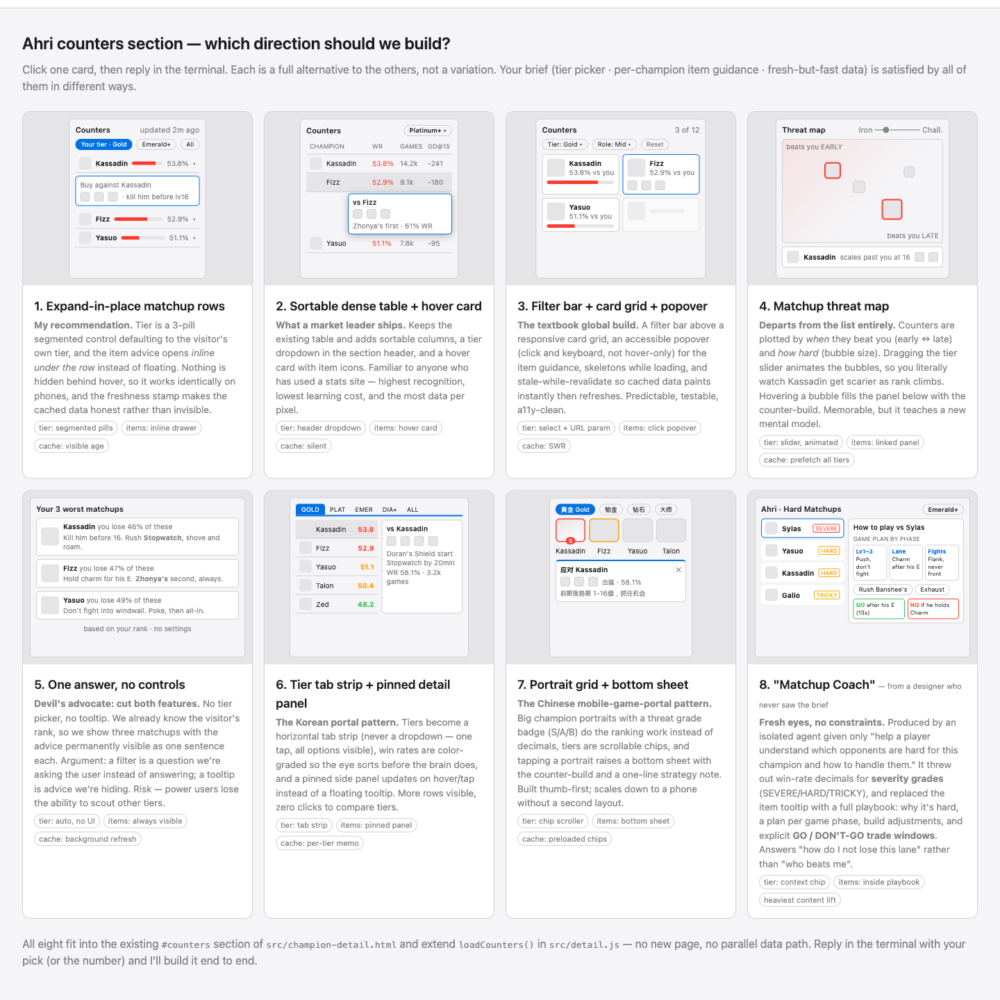

# kargnas/skills

제가 [Claude Code](https://docs.anthropic.com/en/docs/claude-code), Codex,
[OpenCode](https://opencode.ai)에서 사용하고 있는 스킬들 중 일부를 발췌하여 올렸습니다.

각 스킬은 표준 에이전트 스킬 구조인 `skills/<이름>/SKILL.md` 형태로 독립되어 있습니다.

## 전체 스킬 설치

[`npx skills`](https://github.com/vercel-labs/skills)로 모든 스킬을 한 번에 설치합니다.

```bash
npx -y skills add kargnas/skills --skill '*'
```

설치 대상을 직접 선택하려면 다음 명령을 사용합니다.

```bash
npx -y skills add kargnas/skills
```

전역 설치가 필요하면 원하는 명령 끝에 `--global`을 붙입니다.

## 개별 스킬 설치

### `ai-ready`

프로젝트를 분석해 `AGENTS.md`, 디버깅·테스트 환경, CI, 문서를 정비합니다.

```bash
npx -y skills add kargnas/skills --skill ai-ready
```

### `vscode-ready`

프로젝트 기술 스택에 맞는 VS Code/Cursor 실행, 디버그, 작업, 설정 파일을 구성합니다.

```bash
npx -y skills add kargnas/skills --skill vscode-ready
```

### `skill-manager`

스킬의 수정, 병합, 분리, 구조 정리, 외부 스킬 가져오기를 관리합니다. 스킬에 적힌 모델 ID는 실행할 때마다 models.dev에서 조회해 낡은 모델과 최신 대체 모델을 찾습니다.

```bash
npx -y skills add kargnas/skills --skill skill-manager
```

### `skill-prompter`

스킬 단계가 누락되지 않도록 RFC 2119 표현, 명시적 도구, 검증 절차, 이름과 설명을 다듬습니다.

```bash
npx -y skills add kargnas/skills --skill skill-prompter
```

### `humanizer-kill-gpt`

영어와 한국어 글에서 반복되는 GPT·LLM 특유의 문장 구조, 번역체, 과잉 설명을 제거합니다.

```bash
npx -y skills add kargnas/skills --skill humanizer-kill-gpt
```

### `git-lore`

커밋 메시지에 변경의 목적, 밖에서 보이는 변화, 결정과 결정한 사람, 버린 대안, 남은 일을 Git trailer로 기록합니다. 코드를 고치기 전에 이전 결정을 조회하고, 브랜치의 결정을 PR 설명으로 요약하며, 프로젝트 또는 전역 에이전트 지침에 Lore 형식을 설정합니다. 대화 원문은 커밋에 넣지 않습니다.

```bash
npx -y skills add kargnas/skills --skill git-lore
```

### `minimal-patch-with-subagents`

버그 수정 위치를 병렬 서브에이전트들이 독립적으로 토론·투표해, 편집 전에 가장 위험이 낮은 최소 패치를 선택합니다.

```bash
npx -y skills add kargnas/skills --skill minimal-patch-with-subagents
```

### `ui-buffet`

구현하기 전에 8가지 UI/UX 디자인 컨셉을 브라우저 프리뷰로 보여 주고, 사용자가 고른 컨셉을 구현합니다. 컨셉은 추천안, 시장 선도 서비스의 방식, 글로벌 표준 방식, 관습에서 벗어난 방식, 의도적으로 반대 입장을 취한 방식, 한국과 중국 개발자의 표준 방식으로 구성됩니다. 8번째 컨셉은 조건을 전혀 모르는 클린 컨텍스트 서브에이전트가 처음부터 다시 상상합니다. 카드마다 주요 작업을 끝내는 데 필요한 클릭·입력 수를 배지로 표시합니다. 주요 작업에 신규 사용자를 모으거나, 사람 사이에 퍼지거나, 트래픽을 늘리는 기능을 넣을 자리가 있으면, 서브에이전트가 만든 컨셉을 제외한 7개 컨셉이 각자의 방식으로 그런 기능을 함께 설계합니다.

여러 UI/UX 선택지를 요청하거나 구현 전에 디자인을 함께 고민하려는 요청에서 스스로 활성화되며, 이때는 실행할지 한 번 먼저 묻습니다. 스킬 이름으로 직접 호출하면 묻지 않고 바로 실행합니다.

내장된 로컬 서버가 컨셉을 브라우저에 띄우고, 클릭한 컨셉을 기록합니다. 비교 목적에 따라 카드, 나란히 놓은 목업, 실제 화면 크기의 프리뷰를 사용합니다. 레이아웃은 와이어프레임으로, 시각적 완성도는 목업으로 비교하며, 두 방식 모두 프로젝트의 디자인 토큰을 그대로 사용합니다. 아래는 "챔피언 상세 페이지의 카운터 섹션에 티어 필터, 아이템 툴팁, 캐싱을 넣고 싶다"는 요청의 카드형 프리뷰 예시입니다.



Orca 같은 로컬 프록시를 거쳐도 세션 키로 실시간 연결을 인증합니다. 처음 열 때는 `?key=…`가 포함된 주소를 사용합니다. 실행과 연결 확인 방법은 [브라우저 미리보기 가이드](skills/ui-buffet/references/visual-companion.md)를 참고하세요.

```bash
npx -y skills add kargnas/skills --skill ui-buffet
```

### `minimal-frontend`

디자인 시스템이 없는 프로젝트의 프론트엔드 기본값입니다. 앱 화면과 단독 HTML 리포트 페이지가 같은 디자인을 쓰도록, 공통 규칙은 `SKILL.md`에 두고 용도별 규칙은 `app.md`와 `report.md`로 나눴습니다. 공통 규칙에는 최신 shadcn/ui(Base UI, Mira 프리셋)와 Tailwind CSS v4 명명 규칙에 맞춘 테마 토큰, 타입·밀도 스케일, 상태 색, 컨테이너 쿼리 기반 반응형 규칙, 접근성 기준이 들어 있습니다.

앱 화면 규칙은 URL 라우팅, 영역별 비동기 로딩, 테마·언어 기본값, UX 법칙과 CSS 전환 패턴 32개를 담았습니다. 배지, 대화상자, 버튼, 내비게이션, 선택 컨트롤, 날짜·시간 선택, 폼, 목록, 빈 화면에 적용하는 컴포넌트별 정책과 UI 문구 규칙도 들어 있으며, 한국어 UI에만 해당하는 규칙은 따로 표시했습니다. Tailwind CSS v3나 이전 토큰 이름을 쓰는 프로젝트를 위한 대응표도 함께 제공합니다. 리뷰 모드에서는 Vercel Web Interface Guidelines와 함께 `file:line` 형식으로 지적합니다.

리포트 페이지 규칙은 조사 결과나 분석을 사람이 읽는 HTML 파일 하나로 만들 때 적용합니다. shadcn이나 Tailwind 없이 같은 테마 토큰을 일반 CSS로 선언하는 방법, 페이지 골격, 수치·막대·타임라인·노드 그래프·표·배지·인용 블록의 모양, 기록과 발언과 추론을 구분하는 문구 규칙, 전달하기 전에 화면을 확인하는 절차를 담았습니다.

리포트 페이지에는 선택 규칙도 있습니다. 내용에 해당하는 옵션이 있으면 페이지를 만들기 전에 체크박스로 묻고, 체크한 옵션의 파일만 읽어 적용합니다. 옵션은 `report-options/` 폴더에 하나당 파일 하나로 들어 있습니다.

- 인라인 번역: 다른 언어로 된 인용을 페이지 언어로 번역해 본문에 두고, 원문은 마우스 오버, 키보드 포커스, 탭으로 여는 툴팁과 인쇄본에 둡니다.
- 발언자 사진: 사람의 인용 앞에 그 사람의 작은 원형 사진을 붙입니다. 사진은 파일 안에 한 번씩만 넣고, 사진이 없는 사람에게는 사람 아이콘을 씁니다.

```bash
npx -y skills add kargnas/skills --skill minimal-frontend
```

### `report-long-work`

에이전트가 끝낸 작업(마이그레이션, 전환, 정리, 긴 자율 작업)을 그 자리에 없던 사람에게 HTML 페이지 하나로 보고합니다. 페이지에는 읽는 사람이 지금 해야 할 일, 결과 수치, 바뀌기 전과 후의 구조와 작업 순서를 보여 주는 노드 그래프, 검증 결과, 파괴적 작업의 기록 이미지가 들어갑니다. 노드를 누르면 그 자리에서 바뀐 내용과 확인 방법, 근거 기록이 열립니다.

보고서는 작업하는 동안 저장한 기록으로 만듭니다. 삭제처럼 되돌릴 수 없는 작업은 `scripts/evidence.sh`로 실행해 작업 전 상태, 대상 확인, 명령, 작업 후 상태를 기록하고, `scripts/report.py`가 그 기록을 터미널 모양 이미지로 만듭니다. `report.py`는 Chrome으로 페이지를 375·800·1280px에서 라이트·다크 모드로 렌더링해 가로 스크롤, 스크립트 오류, 깨진 이미지, 잘린 그래프를 찾습니다. 채팅 채널에 붙여 넣을 이미지와 이미지를 모두 담은 HTML 파일 하나도 만듭니다. 조사 결과나 분석처럼 보고할 작업이 없는 페이지는 `minimal-frontend`가 맡습니다.

```bash
npx -y skills add kargnas/skills --skill report-long-work
```

### `slack-api-readonly`

Slack 사용자 토큰으로 채널, 스레드 permalink, 검색 결과를 읽기 전용으로 가져와 LLM이 읽기 좋은 마크다운 한 문서로 출력합니다. 사용자 ID를 실명으로 바꾸고 mrkdwn을 풀어 쓰며, 이모지·리액션과 타임존 표기를 유지하고 `--files`로 첨부 파일도 내려받습니다. 데스크톱에서 복사한 Slack 텍스트를 정리하는 필터도 함께 들어 있습니다.

```bash
npx -y skills add kargnas/skills --skill slack-api-readonly
```

### `oss-finder`

GitHub에서 라이브러리, 프레임워크, CLI 도구, 코드를 찾아 스타 수 대신 README를 사람이 손으로 다듬은 날짜 수(polish-days)로 순위를 매깁니다. 회전 PAT 풀, grep.app, Blackbird 웹 인덱스, BigQuery/GHArchive 백엔드와 코드 검색 폴백 체인을 함께 제공하며, `gh search code`가 레이트 리밋에 걸릴 때도 씁니다. 실행할 때마다 PAT 풀 설정을 먼저 확인하고, 없으면 멈춰서 설정 방법을 안내합니다. PAT 풀은 설정 파일의 PAT와 함께, gh가 `hosts.yml`에 저장해 둔 로그인 토큰(`gh-profile` 프로필 포함)도 계정마다 하나씩 씁니다.

```bash
npx -y skills add kargnas/skills --skill oss-finder
```

### `skill-finder`

작업에 맞는 설치 가능한 SKILL.md 스킬 패키지를 `npx skills` 마켓플레이스와 GitHub 전체 스윕에서 찾아, 스타나 설치 수가 아니라 실제 사람이 반복 수정한 날짜 수(semantic polish-days)와 내용 깊이로 순위를 매깁니다. GitHub 검색은 `oss-finder`에 위임하므로 두 스킬을 같은 디렉터리에 함께 설치해야 합니다.

```bash
npx -y skills add kargnas/skills --skill skill-finder oss-finder
```

## Claude Code 플러그인으로 설치

Claude Code에서는 이 저장소를 플러그인 마켓플레이스로 추가할 수도 있습니다.

```text
/plugin marketplace add kargnas/skills
```

```text
/plugin install kargnas-skills@kargnas-plugins
```

## Codex 플러그인으로 설치

Codex CLI 0.146.0 이상이 필요합니다. Codex는 `.agents/plugins/marketplace.json`을 먼저 읽으며, 이 파일은 `npm run version:sync`가 `.claude-plugin/` 매니페스트에서 자동 생성합니다.

```bash
codex plugin marketplace add kargnas/skills
```

```bash
codex plugin add kargnas-skills@kargnas-plugins
```

## 스킬 목록

| 스킬 | 용도 |
| --- | --- |
| [`ai-ready`](skills/ai-ready/) | 프로젝트를 AI 에이전트가 작업하기 쉬운 구조로 정비 |
| [`vscode-ready`](skills/vscode-ready/) | VS Code/Cursor의 실행·디버그·작업 설정 생성 |
| [`skill-manager`](skills/skill-manager/) | 스킬 구조 정리, 병합, 외부 스킬 가져오기 |
| [`skill-prompter`](skills/skill-prompter/) | 스킬 지시문의 실행 준수율과 트리거 문구 개선 |
| [`humanizer-kill-gpt`](skills/humanizer-kill-gpt/) | 영어·한국어 글의 GPT·LLM 문체 흔적 제거 |
| [`git-lore`](skills/git-lore/) | Captures, queries, and configures decision context in native Git trailers |
| [`minimal-patch-with-subagents`](skills/minimal-patch-with-subagents/) | 병렬 서브에이전트 토론으로 확정된 버그의 최소·최저위험 패치 선택 |
| [`ui-buffet`](skills/ui-buffet/) | Previews several UI/UX design concepts in the browser and builds the pick |
| [`minimal-frontend`](skills/minimal-frontend/) | shadcn/ui·Tailwind CSS v4 기반 디자인 시스템 기본값, 컨테이너 기반 반응형 규칙, 영역별 비동기 로딩, 적용형 UX 법칙, 컴포넌트별 정책, UI 문구 규칙, CSS 전환 패턴 32개, 같은 디자인을 쓰는 HTML 리포트 페이지 규칙 |
| [`report-long-work`](skills/report-long-work/) | 에이전트가 끝낸 작업을 노드 그래프, 검증 결과, 파괴적 작업 기록 이미지가 담긴 HTML 페이지로 보고 |
| [`slack-api-readonly`](skills/slack-api-readonly/) | Slack 채널·스레드·검색 결과를 읽기 전용 Web API로 가져와 LLM용 마크다운으로 변환 |
| [`oss-finder`](skills/oss-finder/) | GitHub 레포·코드를 polish-days 기준으로 찾아 순위화하는 검색 백엔드 툴킷 |
| [`skill-finder`](skills/skill-finder/) | 설치 가능한 SKILL.md 스킬을 마켓플레이스와 GitHub에서 찾아 semantic polish-days로 순위화 |

## 라이선스

[PolyForm Noncommercial 1.0.0](LICENSE)에 따라 개인, 연구 및 기타 비상업적
용도로 무료 사용할 수 있습니다. 상업적 이용에는 저자의 별도 허가가 필요합니다.
